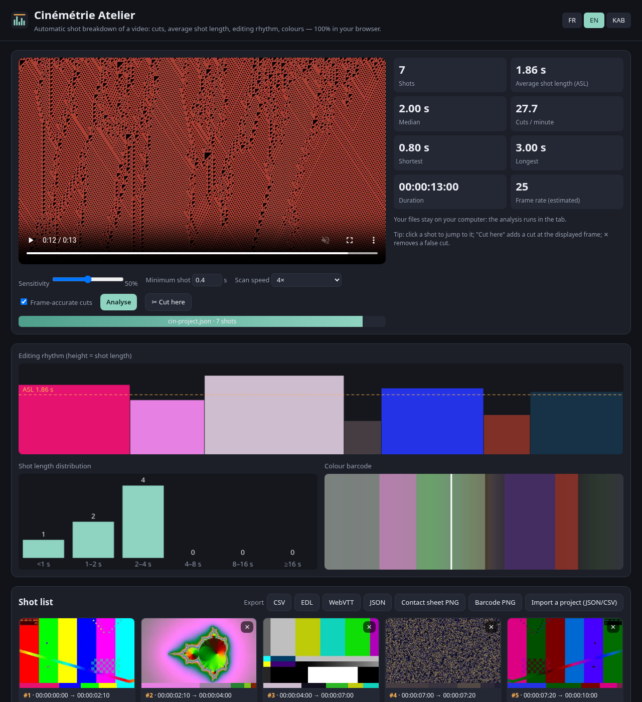

# Cinémétrie Atelier — découpage en plans, ASL et rythme du montage, dans le navigateur

**🇫🇷** Déposez une vidéo : l'outil trouve **toutes les coupes** (à l'image près), calcule la **durée moyenne des plans (ASL)**, la médiane, les coupes par minute, dessine le **rythme du montage**, la **répartition des durées** et un **code-barres couleur** du film, extrait une **vignette et une palette par plan**, et exporte une **planche-contact PNG**, un **EDL CMX3600**, un **CSV**, des **chapitres WebVTT** et un projet **JSON**. **Rien n'est envoyé** : tout se passe dans l'onglet.
**🇬🇧** Drop a video: frame-accurate cut detection, average shot length (ASL), editing-rhythm chart, shot-length histogram, colour barcode, a thumbnail and palette per shot, and exports (contact sheet PNG, CMX3600 EDL, CSV, WebVTT chapters, JSON). Nothing is uploaded. English section below.
**ⵣ Taqbaylit** : tigezmi ddaw-a.

👉 **Démo : https://salimadour31-boop.github.io/cinemetrie-atelier/**

## Pour qui ?
- **Monteurs et étudiants en cinéma** : analyser le découpage d'une scène de référence (combien de plans, quelle durée moyenne, où le rythme s'accélère) — le travail que faisait *Cinemetrics*, aujourd'hui difficile à utiliser.
- **Étalonneurs / chefs opérateurs** : une palette et une vignette par plan, un code-barres couleur du film entier.
- **Réalisateurs, clips, pubs** : une planche-contact à envoyer, un EDL pour retrouver les plans dans DaVinci Resolve / Premiere, des chapitres pour un lecteur web.

## Mode d'emploi
1. Ouvrez la [démo](https://salimadour31-boop.github.io/cinemetrie-atelier/) (Chrome, Edge, Firefox ou Safari récents) et **déposez votre vidéo** (MP4/MOV en H.264, WebM…).
2. Réglez si besoin : **Sensibilité** (plus haut = plus de coupes), **Plan minimum** (ignore les coupes trop rapprochées), **Vitesse d'analyse** (4× par défaut ; 16× est plus rapide mais peut rater des plans très courts).
3. Cliquez **Analyser**. Laissez l'onglet visible pendant l'analyse.
4. Vérifiez avec les vignettes : **✕** supprime une fausse coupe ; placez la vidéo sur la bonne image et cliquez **✂ Couper ici** pour en ajouter une. Ajoutez des **notes** par plan.
5. **Exporter** : CSV (tableur), EDL (Resolve : *File › Import › Timeline › EDL* ; Premiere : *Fichier › Importer*), WebVTT (chapitres), JSON (pour reprendre plus tard via **Importer un projet**), planche-contact PNG, code-barres PNG.

## Comment ça marche
- La vidéo est lue en accéléré, muette ; chaque image présentée (`requestVideoFrameCallback`) est réduite à 64×36 px.
- Pour chaque image : histogramme de **chromaticité** (indépendant de la luminosité, pour que les scènes de nuit marchent), **structure** en niveaux de gris normalisés 16×9, couleur moyenne.
- Une coupe = un pic de différence qui **dépasse nettement son voisinage** (seuil adaptatif sur ±1,5 s), au-dessus d'un plancher, et qui **n'est pas un flash** (l'image d'après ressemble à celle d'avant).
- **À l'image près** : chaque coupe est affinée par recherche dichotomique en se plaçant image par image (cadence mesurée en lisant ~16 images à vitesse normale).

## Tests
- **14 tests unitaires** (`npm test`) sur des images synthétiques : coupes trouvées sans faux positifs, **scènes sombres (25 %)**, **flash d'une image ignoré**, caméra à l'épaule bruitée, plan minimum, échantillonnage irrégulier, statistiques, timecodes, CSV/EDL/VTT/JSON (aller-retour), palette, cadence.
- **Test de bout en bout dans un vrai navigateur** (`tests/e2e.mjs`, Playwright/Chromium) sur un **film de test généré par ffmpeg** (`tests/make-video.sh`) : 7 plans, un plan de nuit, un panoramique et un flash blanc d'une image. Les **6 coupes sont trouvées à l'image exacte** à 1×, 4× et 16×, sans fausse coupe ; vérifie aussi les exports, la fusion/ajout de coupe, l'import JSON et les langues.
- CI GitHub Actions : tests unitaires + bout en bout à chaque commit.

## Limites
- Les **fondus enchaînés lents**, fondus au noir et effets de transition progressifs ne sont pas détectés comme coupes (ou au mauvais endroit) ; les flashs de plus de ~0,5 s peuvent compter comme deux coupes.
- Formats : ce que **votre navigateur** sait lire (H.264/MP4 et WebM partout ; MKV, ProRes, HEVC selon le navigateur).
- La vitesse dépend de votre machine ; à 16× certains navigateurs sautent beaucoup d'images (les plans < 0,5 s peuvent être manqués).
- Cadences variables (VFR, vidéos de téléphone) : les timecodes sont arrondis à la cadence mesurée ; l'EDL est en non-drop-frame.
- Pas d'analyse des mouvements de caméra ni des valeurs de plan (gros plan, plan large…).

---

## 🇬🇧 English
**Cinémétrie Atelier** is a free (MIT), private, in-browser shot-breakdown tool for editors, film students, colourists and directors. Drop a video and get frame-accurate cuts, ASL, median shot length, cuts per minute, an editing-rhythm chart, a shot-length histogram, a colour barcode, one thumbnail and palette per shot, and exports: contact sheet PNG, CMX3600 EDL (import into Resolve/Premiere), CSV, WebVTT chapters, JSON project (re-importable). Fix the result by hand (✕ removes a cut, "Cut here" adds one) and add notes.
Detection: brightness-invariant chromaticity histogram + normalised structure, adaptive local threshold, flash rejection, then per-cut binary search by seeking for frame accuracy. Tested with 14 unit tests and an end-to-end browser test on an ffmpeg-generated film (all 6 cuts at the exact frame at 1×, 4× and 16×). Limits: slow dissolves/fades are not detected, formats depend on the browser, 16× may miss very short shots, VFR footage is rounded.

## ⵣ Taqbaylit
**Cinémétrie Atelier** d afecku n baṭel (MIT) i yettbeṭṭun tavidyut ɣer tmuɣliwin (plans) srid deg yiminig : ad yaf akk tigzumin (s tugna), ad yeḥseb tanzagt talemmast n tmuɣliwin (ASL), ad d-yesken riṭm n umuntaj d yiniten n yal tamuɣli, syin ad yessifeḍ tawriqt n tmuɣliwin (PNG), EDL, CSV, WebVTT d JSON. Ulac ayen ara yettwaznen ɣer Internet.
Amek : ssers tavidyut, sit ɣef **Sleḍ**, ssenqed s tugniwin (✕ ad yekkes tagzumt, « Gzem da » ad yernu yiwet), syin **Sifeḍ**.

## Licence
MIT © 2026 salimadour31-boop. Aucune dépendance à l'exécution ; Playwright (Apache-2.0) et ffmpeg ne servent qu'aux tests.
